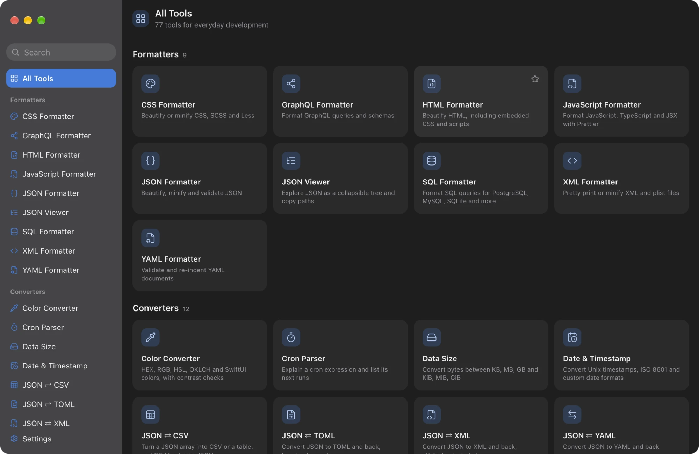
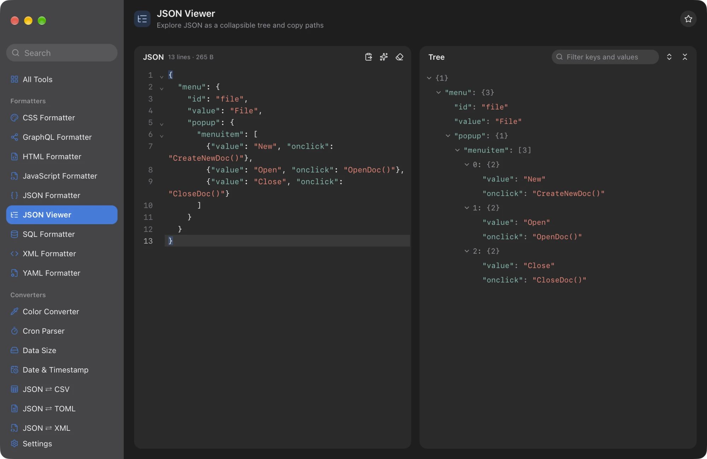

  

<h1 align="center">Dojo</h1>

  Every developer tool in one free Mac app. 
  Format, convert, encode, generate and test, without a browser tab.

  <a href="https://github.com/IndieGoodies/Dojo/releases/latest">Download for macOS</a>

## Tools

80+ tools, grouped in a sidebar and a searchable grid:

| Category | Examples |
|---|---|
| Formatters | JSON, XML, SQL, HTML, CSS, JavaScript, YAML, GraphQL |
| Converters | Color, Cron, Date & Timestamp, JSON ⇄ CSV / XML / TOML / YAML, JSON to Code |
| Encoders & Decoders | Base64, Base32 & Base58, JWT, GZIP, HTML Entities, Cookies, Basic Auth |
| Generators | Hash, HMAC, Bcrypt, UUID, Nano ID, TOTP, Lorem Ipsum, App Icon Set |
| Text | Regex Tester, Markdown Preview, Text Diff, List Compare, Slugify, Line Tools |
| Testers | JSON Diff, JSON Schema, JSONPath, Semver, Password Strength |
| Graphics | Image Converter, Image Compressor, Contrast Checker, Tints & Shades, Color Blindness |
| Utilities | Calculator, Chmod, HTTP Status Codes, MIME Types, IPv4 Subnet, Key Codes |

Tools run locally on your Mac; only Public IP goes online. Built with Tauri 2 (Rust) and React 19.

## Docs

- [Development](docs/development.md): requirements, running the app, tests
- [Release](docs/release.md): signing, notarizing and publishing an update
- [AGENTS.md](AGENTS.md): folder layout, adding a tool, the design system

## License

GNU Affero General Public License v3.0 (AGPL-3.0). See [LICENSE](LICENSE).
